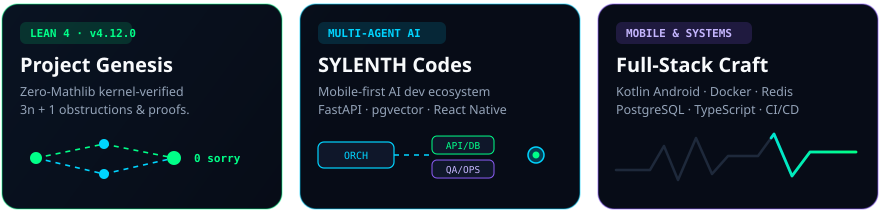
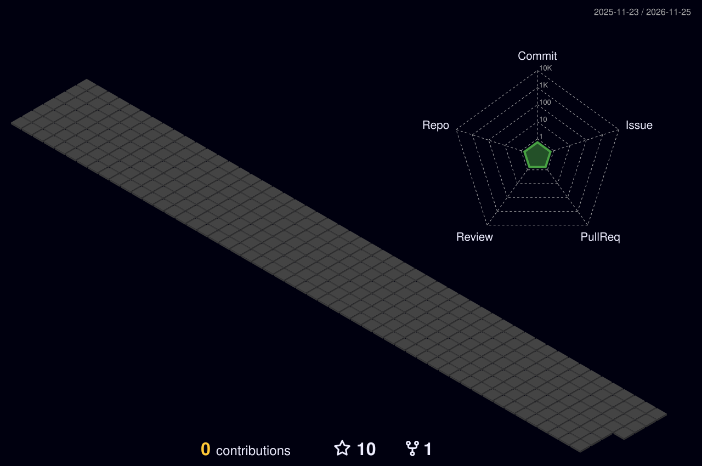

  

  
  
  

  

  

  

<table>
  <tr>
    <td width="64%" valign="top">

### ⚡ About Me

- 🔬 Building **[Project Genesis](https://github.com/sylenthai/project-genesis)** — zero-Mathlib, kernel-verified **Lean 4 (`v4.12.0`)** formalizations & reductions ([Interactive Blueprint](https://sylenthai.github.io/project-genesis/))
- 🤖 Architecting **SYLENTH Codes** — a multi-agent AI software development ecosystem (`Python` · `FastAPI` · `pgvector` · `React Native`)
- 📱 Crafting native Android & cross-platform apps (`Kotlin` · `TypeScript` · `Docker`)
- 🧠 Exploring autonomous agent orchestration, theorem proving, and low-latency systems
- 📫 Contact: **sylenthai@gmail.com**

    </td>
    <td width="36%" align="center" valign="middle">
      
    </td>
  </tr>
</table>

  

### 🕹️ Arcade Contribution Matrix — Pac-Man

  <picture>
    <source media="(prefers-color-scheme: dark)" srcset="https://raw.githubusercontent.com/sylenthai/sylenthai/output/pacman-contribution-graph-dark.svg" />
    <source media="(prefers-color-scheme: light)" srcset="https://raw.githubusercontent.com/sylenthai/sylenthai/output/pacman-contribution-graph.svg" />
    
  </picture>

### 🏙️ 3D Isometric Contribution Skyline

  <picture>
    <source media="(prefers-color-scheme: dark)" srcset="./profile-3d-contrib/profile-night-green.svg" />
    <source media="(prefers-color-scheme: light)" srcset="./profile-3d-contrib/profile-green-animate.svg" />
    
  </picture>

  

### 🛠️ Tech Arsenal

#### Languages & Formal Verification

  
  
  
  
  
  

#### AI, Backend & Mobile

  
  
  
  
  

#### Data, Infrastructure & Ops

  
  
  
  
  
  

#### Highlighted Work

  
  
  

  

### 📊 Live Telemetry & Activity

  

  

  
  
  

  

### 🐍 Contribution Snake

  <picture>
    <source media="(prefers-color-scheme: dark)" srcset="https://raw.githubusercontent.com/sylenthai/sylenthai/output/github-snake-dark.svg" />
    <source media="(prefers-color-scheme: light)" srcset="https://raw.githubusercontent.com/sylenthai/sylenthai/output/github-snake.svg" />
    
  </picture>

