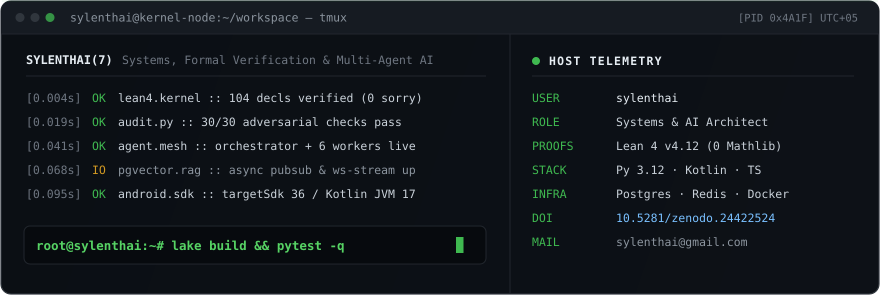
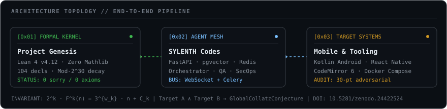

<div align="center">
  
</div>

<br />

### `// 01. IDENTITY_SPEC`

```lean
structure Engineer where
  handle       : String := "sylenthai"
  focus        : List String := ["Formal Verification", "Multi-Agent AI", "Systems Engineering"]
  verification : String := "Lean 4 v4.12.0 · Zero Mathlib · 104 kernel-verified decls"
  architecture : String := "Python 3.12 · FastAPI · pgvector · Redis · Kotlin · TypeScript"
  discipline   : String := "Adversarial auditing, mathematical rigor, zero-fluff shipping"
  contact      : String := "sylenthai@gmail.com"
```

<div align="center">
  
</div>

### `// 02. SYSTEMS_TOPOLOGY`

<div align="center">
  
</div>

<div align="center">
  
</div>

### `// 03. ACTIVE_WORK & RESEARCH`

| Module | Domain | Core Engineering | Artifacts |
| :--- | :--- | :--- | :--- |
| **[Project Genesis](https://github.com/sylenthai/project-genesis)** | Formal Methods (`Lean 4`) | Zero-Mathlib kernel-verified 3n+1 cycle obstructions, dual-adic collapse, Stammering Bit-Exhaustion, Mod-2³⁰ cylinder contraction (`0 sorry`, `0 admit`, 30-pt adversarial audit) | [Blueprint](https://sylenthai.github.io/project-genesis/) · [Zenodo DOI](https://doi.org/10.5281/zenodo.24422524) |
| **SYLENTH Codes** | Multi-Agent AI Platform | Mobile-first autonomous dev orchestrator (`Orchestrator → Backend / Frontend / DB / QA / Security / DevOps`), live WebSocket telemetry, `CodeMirror 6`, RAG (`pgvector`) | `FastAPI` · `Celery` · `React Native` |
| **EmberAndAshAndroid** | Native Systems / Mobile | Strategy & board engine built natively for Android (`SDK 36`, `Java 17`, `Kotlin` / Gradle KTS) | `Kotlin` · `Android` |

<div align="center">
  
</div>

### `// 04. TECHNICAL_MATRIX`

| Layer | Stack |
| :--- | :--- |
| **Verification & Math** | `Lean 4 (v4.12.0)` · `Lake` · `Adversarial Auditing (Python)` |
| **Languages** | `Python 3.12` · `TypeScript` · `Kotlin` · `JavaScript` · `Bash` |
| **Backend & Data** | `FastAPI` · `AsyncIO` · `PostgreSQL (pgvector)` · `SQLAlchemy 2.0` · `Alembic` · `Redis 7` · `Celery` |
| **Clients & Infra** | `React Native` · `Android SDK` · `CodeMirror 6` · `Docker` · `Nginx` · `GitHub Actions` |

<div align="center">
  
</div>

### `// 05. CONTRIBUTION_TOPOLOGY`

<p align="center">
  <picture>
    <source media="(prefers-color-scheme: dark)" srcset="./profile-3d-contrib/profile-night-green.svg" />
    <source media="(prefers-color-scheme: light)" srcset="./profile-3d-contrib/profile-green-animate.svg" />
    
  </picture>
</p>

<p align="center">
  <picture>
    <source media="(prefers-color-scheme: dark)" srcset="https://raw.githubusercontent.com/sylenthai/sylenthai/output/github-snake-dark.svg" />
    <source media="(prefers-color-scheme: light)" srcset="https://raw.githubusercontent.com/sylenthai/sylenthai/output/github-snake.svg" />
    
  </picture>
</p>

---

<p align="center">
  <sub><code>sylenthai@gmail.com</code> &nbsp;·&nbsp; <a href="https://doi.org/10.5281/zenodo.24422524">DOI: 10.5281/zenodo.24422524</a> &nbsp;·&nbsp; <a href="https://sylenthai.github.io/project-genesis/">Interactive Theorem Blueprint</a></sub>
</p>
